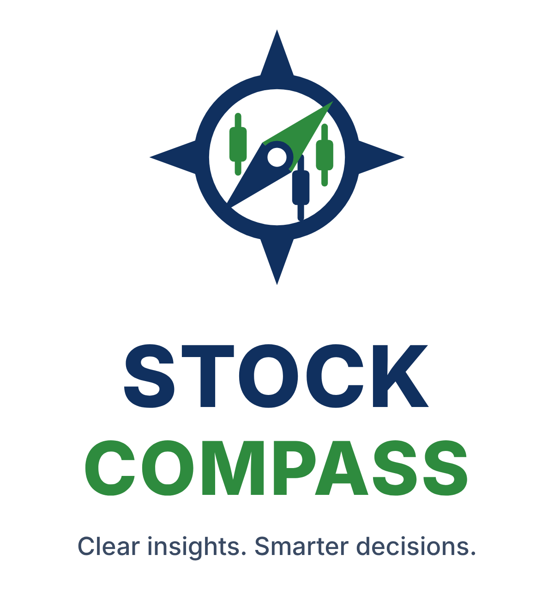

<p align="center"></p>

# Stock Compass

A plain-language stock research app for everyday and diaspora investors. You pick what you want from your money, and Stock Compass ranks well-known stocks from Africa, North America, Europe and Asia by how well they fit. Each stock gets clear verdicts, strengths, risks and a cost calculator in your own currency. It never tells you to buy or sell. It gives you the information to decide.

Built with Claude (Anthropic) in October 2026.

**[Download for Windows or Mac](https://anyanso.github.io/stock-compass/download.html)** · **[Use it in your browser](https://anyanso.github.io/stock-compass/)**

## Why it exists

Most stock apps are built for people investing in their own country, and they assume you already speak finance. Stock Compass is built for people like me: living in Canada, investing in Nigerian and global companies, often through family back home, and wanting answers in plain English and in my own currency.

## Features

- **Goal-based ranking.** Choose "Steady income", "Grow my money", "Play it safe" or "A bit of everything", and the list re-ranks by match score.
- **Plain-language verdicts.** Each stock is rated on dividend income, profitability, growth, price versus earnings, and risk, with a one-sentence summary and a short explanation per measure.
- **Strengths, risks and a checklist.** These are generated from the numbers, plus notes specific to each company, and end with the questions to answer before investing.
- **"What would it cost me?" calculator.** Converts share prices into CAD, NGN, USD, GBP, EUR and more, and estimates yearly dividend income.
- **Side-by-side comparison** of up to three stocks, highlighting the best value in each row.
- **About the company.** What each company does, how it makes money, brands you'd know and its background.
- **1- and 5-year outlook.** Bad, typical and good cases for your amount, with the chance of being down.
- **Live prices** from Finnhub or Alpha Vantage, with dividend yield and P/E adjusted to the live price. Non-US stocks use their US listings, converted back to the home-market price.
- **Works with your broker.** Import your Wealthsimple holdings (TFSA, RRSP, FHSA and more), or link Questrade read-only in the desktop app. "Buy in Wealthsimple" and "Buy in Questrade" buttons take you straight to your broker to finish a purchase.
- **African markets.** Nigerian, Kenyan, South African and West African (BRVM) stocks, plus the VanEck Africa ETF. Pick an African platform (Bamboo, mystocks.africa or Daba) and the buy button routes each stock to the right place, or drafts a message for family who buy on your behalf. Statements from these platforms can be imported as CSV.
- **App lock.** An optional passcode that encrypts your holdings and keys on your device.
- **Shared family portfolio.** Holdings, status (planned, applied, holding, sold), who contributed what, and totals in your chosen currency, synced live between family members.
- **Shared watchlist** and **add-your-own stock** form for companies not in the list.
- **AI write-ups.** A "deeper analysis" button asks Claude for a neutral brief on any company (desktop app with your own Anthropic key, or inside Claude).
- Works on phones, and in light and dark mode.

## How the scoring works

Each stock gets five scores out of 100:

| Measure | Based on |
|---|---|
| Dividend income | Dividend yield, reduced if the company pays out more than it earns |
| Profitability | Net profit margin |
| Growth | Revenue growth over the latest year |
| Price vs earnings | P/E ratio (lower scores as cheaper) |
| Risk level | Debt-to-equity, price volatility (beta), and an emerging-market adjustment |

Your chosen goal weights these five into a single match score. The formula is deliberately simple and transparent. It is a starting point for research, not a prediction.

## Ways to use it

The same app runs in three places:

| | In your browser | Desktop app (Windows, Mac) | Inside Claude |
|---|---|---|---|
| Explorer, scores, outlook, comparison, calculator | ✅ | ✅ | ✅ |
| Live prices | ✅ your own free Finnhub or Alpha Vantage key | ✅ same, keys encrypted | ✅ Alpha Vantage connector |
| Wealthsimple holdings import | ✅ | ✅ | ✅ |
| Questrade live connection (read-only) | — | ✅ | — |
| AI company write-ups | — | ✅ your own Anthropic key | ✅ |
| Portfolio | saved in this browser | saved on this computer | shared live with family |
| App lock (passcode, encrypted data) | ✅ | ✅ | — |

### Importing from Wealthsimple

1. On a computer, log in at [my.wealthsimple.com](https://my.wealthsimple.com). The report isn't available in the phone app.
2. Open your **Profile** menu and choose **Documents**.
3. Click **Request documents** (or **Generate document**) and choose **Holdings report (CSV)**.
4. Select your accounts and click **Download CSV**.
5. In Stock Compass, go to **Portfolio → Import holdings** and drop the file in.

The file is read on your device and never uploaded. Importing again replaces the previous import and keeps any who-paid amounts you recorded.

### Connecting Questrade (desktop app)

1. Log in to Questrade on the web and open the API centre (App Hub).
2. Register a personal app with permission to read account data, then generate a token.
3. In Stock Compass, go to **Settings → Your broker → Questrade**, paste the token and click **Connect**.

Stock Compass can only read your accounts. Questrade only allows trading through approved partner apps, so purchases happen in Questrade itself.

## Security and privacy

- **No server, no accounts.** Stock Compass has no backend. Your holdings and settings stay on your device, and it never asks for banking details or your broker password.
- **Encrypted keys.** The desktop app encrypts API keys with your operating system's secure storage (Windows DPAPI, macOS Keychain). The page itself never receives them; a separate process uses them and only talks to the services listed below.
- **App lock.** An optional passcode encrypts your holdings and keys with AES-256-GCM, using a key derived from the passcode (PBKDF2, 310,000 iterations). The passcode can't be recovered, by design.
- **Limited network access.** The desktop app only connects to Finnhub, Alpha Vantage, Anthropic and Questrade. Links open in your normal browser.

### Building the desktop app

```bash
cd desktop
npm install
npm start        # run it locally
npm run dist     # build an installer for your computer
```

Pushing a version tag (for example `v1.0.1`, matching `desktop/package.json`) makes GitHub Actions build the Windows, Mac and Linux installers and attach them to a release, which the download page picks up automatically.

## Data and limitations

- Fundamentals (margins, growth, debt, payout) are approximate reference values as of mid-2026, compiled from public results. Nigerian figures come from H1 2026 results and Q3 2026 prices.
- Live prices depend on free tiers: Finnhub allows 60 requests a minute; Alpha Vantage about 25 a day. Prices are cached to stretch these limits.
- The installers aren't code-signed yet, so Windows and macOS show a warning the first time. The download page explains how to continue.
- Nigerian Exchange (NGX) stocks have no live feed and use reference or user-entered prices.
- Exchange rates are approximate.

**Not financial advice.** Always confirm current figures with an official source before investing.

## Roadmap

- Live NGX, Nairobi and Johannesburg data
- Returns shown in your home currency after exchange-rate moves
- IPO and public offer tracker (e.g. the 2026 Dangote Refinery IPO)
- Step-by-step "how to buy" guides for investors abroad
